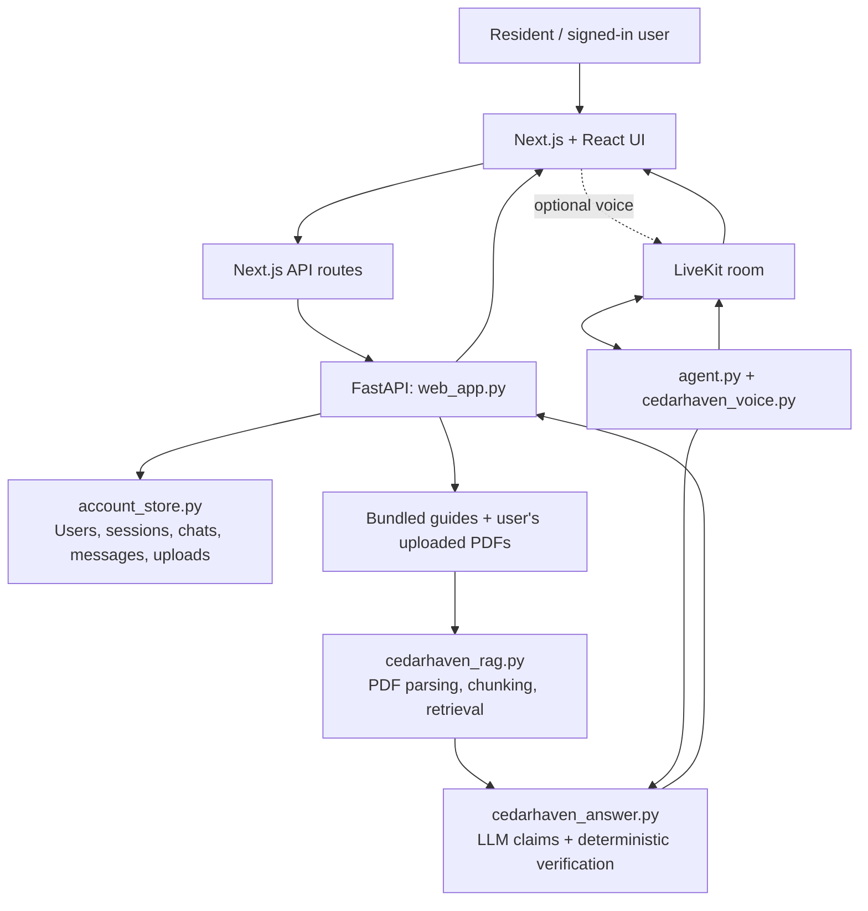

# Cedarhaven Municipal Information Assistant

A citation-first AI assistant for municipal information. It answers questions using the three supplied Cedarhaven guides and optional PDFs uploaded by a signed-in user. Rather than trusting generated prose, the backend verifies every answer claim against quoted source text before returning it. The project also includes account-based chat history and an optional real-time voice interface.

> **Core principle:** no supporting passage, no factual claim. When evidence is missing or cannot be verified, the assistant returns a safe gap/refusal response instead of guessing.

## Contents

- [Features](#features)
- [Architecture](#architecture)
- [How an answer works](#how-an-answer-works)
- [Technology stack](#technology-stack)
- [Requirements](#requirements)
- [Local setup](#local-setup)
- [Environment variables](#environment-variables)
- [Run and test](#run-and-test)
- [API overview](#api-overview)
- [Project structure](#project-structure)
- [Security and privacy notes](#security-and-privacy-notes)
- [Known limitations](#known-limitations)
- [Demo walkthrough](#demo-walkthrough)
- [Further code documentation](#further-code-documentation)

## Features

- **Evidence-grounded answers:** responses are assembled from claims whose quotes are found in retrieved source passages.
- **Precise citations:** citations identify the document, PDF page, and guide section where available.
- **Hybrid text retrieval:** combines multiple lexical ranking signals and question coverage checks.
- **Safe handling of unknowns:** insufficient evidence produces a gap or out-of-scope response.
- **Account-based workspace:** sign-up/sign-in, private chat history, and saved messages.
- **Private PDF uploads:** each account's uploaded documents are retrieved only for that account's questions.
- **Voice interaction (optional):** LiveKit rooms, Deepgram speech-to-text/text-to-speech, spoken answers, and a live evidence panel.
- **Tests and evaluations:** unit tests for answer verification plus retrieval and end-to-end evaluation scripts.
- **Graceful fallback:** when the model is unavailable or no API key is configured, the app can return relevant passages verbatim with citations.

## Architecture



### Main responsibilities

| Layer | Main files | Responsibility |
|---|---|---|
| Web UI | `voice-ui/app/`, `voice-ui/components/` | Sign-in, chat, uploads, source display, and voice experience |
| Web server routes | `voice-ui/app/api/` | Browser-facing API routes and LiveKit token creation |
| HTTP backend | `web_app.py` | Authenticated endpoints, upload validation, chat orchestration, and response persistence |
| Persistence | `account_store.py` | Users, sessions, chats, messages, and upload metadata in PostgreSQL (SQLite development fallback) |
| Retrieval | `cedarhaven_rag.py` | Extract text, split into citation-aware chunks, score and select passages |
| Answer verification | `cedarhaven_answer.py` | Structured model output, quote/number checks, citation composition, and fail-closed behavior |
| Voice | `agent.py`, `cedarhaven_voice.py` | LiveKit agent lifecycle, speech interaction, and evidence payloads |
| Quality checks | `tests/`, `evals/` | Regression tests and retrieval/end-to-end evaluation |

## How an answer works

1. **Load and prepare documents.** The retrieval layer extracts selectable PDF text and splits it into chunks that retain document IDs, page numbers, section labels, headings, and citation metadata.
2. **Search for evidence.** The question is split into useful subqueries and ranked with several text-based signals, including BM25, character n-gram TF-IDF, synonym expansion, and term-coverage scoring.
3. **Apply a relevance gate.** If the retrieved text does not adequately cover the question, the system avoids asking the LLM to invent an answer.
4. **Ask for structured claims.** When configured, the Groq-hosted model (through an OpenAI-compatible client) returns claims with source identifiers and supporting quotations rather than free-form prose.
5. **Verify claims in application code.** Each quote must match its cited passage under the project's normalization rules. Numeric details in a claim must be grounded in its quote. Invalid claims are rejected; a repair attempt may be made when configured.
6. **Compose the response.** The application creates the visible answer and citations from verified claims only. If verification yields no usable claim, it fails closed or returns a safe document-gap statement.
7. **Save and display.** The authenticated backend saves the question, answer, and source metadata to the user's chat. In voice mode, the same verified answer is published to the LiveKit room and spoken.

The LLM proposes claims; **the application verifier decides which claims are allowed through**.

## Technology stack

- **Backend:** Python, FastAPI, Uvicorn, Pydantic
- **PDF and retrieval:** pypdf, rank-bm25, scikit-learn TF-IDF, NumPy
- **LLM client:** OpenAI-compatible Python SDK configured for Groq
- **Persistence and authentication:** PostgreSQL via psycopg, SQLite development fallback, Argon2 password hashing
- **Frontend:** Next.js, React, TypeScript, Tailwind CSS, Radix/shadcn-style components
- **Voice:** LiveKit Agents/Client, Deepgram STT/TTS, Silero plugin
- **Quality:** pytest, retrieval evaluations, optional live-model evaluations

## Requirements

- Python 3.10+ recommended (use a currently supported Python version compatible with the installed packages)
- Node.js compatible with the version of Next.js in `voice-ui/package.json`
- `pnpm` (recommended for the frontend)
- A Groq API key for generated answers; without it, retrieval/extractive fallback can still work
- PostgreSQL for account-enabled use and production-like local testing
- LiveKit and Deepgram credentials only if you want voice mode

## Local setup

Commands below use PowerShell on Windows. Run them from the repository root (the folder containing `web_app.py`).

### 1. Set up Python

```powershell
py -m venv .venv
.\.venv\Scripts\Activate.ps1
python -m pip install --upgrade pip
pip install -r requirements.txt
Copy-Item .env.example .env
```

Edit `.env` and configure at least `GROQ_API_KEY`. For account-enabled operation, configure a reachable PostgreSQL database in `DATABASE_URL`. Ensure the database exists and the credentials have permission to create/use the application's tables.

### 2. Start the FastAPI backend

```powershell
python -m uvicorn web_app:app --reload --reload-dir . --reload-include "*.py" --reload-exclude "voice-ui/node_modules/**" --reload-exclude "voice-ui/.next/**" --reload-exclude ".venv/**"
```

Backend: `http://127.0.0.1:8000`

### 3. Set up the Next.js application

Open a second PowerShell terminal at the repository root:

```powershell
Set-Location voice-ui
Copy-Item .env.example .env.local
pnpm install
pnpm dev
```

Frontend: `http://localhost:3000`

Check `voice-ui/.env.example` and the frontend README for the exact required frontend variables. In particular, configure the backend URL and database/session settings consistently with the backend. Keep `.env` and `.env.local` private; never commit real keys or passwords.

### 4. Documents

The three bundled PDFs should remain in the repository root:

- `01_Cedarhaven_Service_Request_Management.pdf`
- `02_Cedarhaven_Bylaw_Enforcement.pdf`
- `03_Cedarhaven_Permits_and_Licensing.pdf`

Uploaded PDFs must contain selectable text. Image-only scans currently require OCR, which is not included.

## Environment variables

The root `.env.example` documents backend and optional voice settings. The frontend has its own `voice-ui/.env.example`.

| Variable | Purpose |
|---|---|
| `GROQ_API_KEY` | Enables LLM-based structured claim extraction |
| `DATABASE_URL` | PostgreSQL connection string; SQLite may be used by development fallback code when the PostgreSQL configuration/driver is unavailable |
| `UPLOAD_DIR` | Private server-side storage directory for uploaded PDFs |
| `FRONTEND_URL` | Frontend origin used by the backend for redirects/configuration |
| `APP_ENV` | Set to `production` to enable production startup checks |
| `CORS_ORIGINS` | Comma-separated allowed frontend origins |
| `LIVEKIT_URL`, `LIVEKIT_API_KEY`, `LIVEKIT_API_SECRET` | LiveKit server credentials for voice rooms and agent connectivity |
| `AGENT_NAME` | LiveKit agent name, defaulted in the example to `assistant-b92` |
| `DEEPGRAM_API_KEY` | Deepgram speech recognition/synthesis credentials |
| `DEEPGRAM_STT_MODEL`, `DEEPGRAM_STT_LANGUAGE`, `DEEPGRAM_TTS_MODEL` | Optional speech model/language settings |

Use the actual frontend `.env.example` as the source of truth for frontend-only variables; do not copy secrets into client-side `NEXT_PUBLIC_*` variables.

## Run and test

From the repository root:

```powershell
# Core verifier tests (no live API key required)
python -m pytest tests -q

# Retrieval quality against the supplied evaluation cases
python evals/run_retrieval_evals.py -v

# End-to-end checks using the configured live model (requires credentials)
python evals/run_e2e_evals.py

# Optional voice dependencies and voice tests
pip install -r requirements-voice.txt
python -m pytest tests -q
```

Run the LiveKit agent separately when voice credentials and dependencies are configured:

```powershell
python agent.py download-files
python agent.py dev
```

The frontend must also be running for the full web experience. Voice agent and web app are separate processes.

## API overview

Authenticated routes use the backend's bearer-token dependency. The Next.js layer is responsible for browser session handling and calls the Python backend.

| Method | Route | Purpose |
|---|---|---|
| `POST` | `/api/auth/signup` | Create an account and session |
| `POST` | `/api/auth/login` | Authenticate and create a session |
| `POST` | `/api/auth/logout` | Revoke the current session |
| `GET` | `/api/me` | Return the signed-in user |
| `GET` / `POST` | `/api/chats` | List or create chats |
| `GET` | `/api/chats/{chat_id}/messages` | Load a chat's messages |
| `POST` | `/api/chats/{chat_id}/ask` | Ask a question in a chat and save the response |
| `GET` / `POST` | `/api/uploads` | List or upload PDFs for the signed-in user |
| `GET` | `/health` | Basic health endpoint |

The exact response schema is implemented in `web_app.py` and the frontend route handlers. The backend also contains a legacy standalone HTML interface; the account-enabled product flow is the Next.js app.

## Project structure

```text
.
├── web_app.py                    # FastAPI endpoints and request orchestration
├── account_store.py              # DB schema and account/chat persistence
├── cedarhaven_rag.py              # PDF parsing, chunking, retrieval and ranking
├── cedarhaven_answer.py           # LLM claims, verification and cited answer composition
├── cedarhaven_voice.py            # Verified answer to voice/payload adapter
├── agent.py                       # LiveKit agent entry point
├── 01_Cedarhaven_*.pdf            # Bundled reference guides
├── requirements.txt               # Core Python dependencies
├── requirements-voice.txt         # Optional voice dependencies
├── tests/                         # Unit and regression tests
├── evals/                         # Retrieval and end-to-end evaluation tools
├── docs/DEMO.md                   # Demo script and code-tour checklist
└── voice-ui/                      # Next.js + TypeScript browser application
    ├── app/api/                   # Next.js server route handlers
    ├── app/components/            # Main screens and account chat
    ├── components/                # Reusable UI, voice and evidence components
    ├── hooks/                     # React hooks
    ├── lib/                       # Frontend utilities
    ├── public/                    # Static assets
    └── package.json               # Frontend scripts and dependencies
```

## Security and privacy notes

- Passwords are hashed; raw passwords should never be stored.
- User-specific chat and upload lookups are scoped by user ID in the persistence/API layer.
- The answer pipeline treats retrieved documents and the question as untrusted content and validates the model's output against source passages.
- Configure HTTPS, a managed PostgreSQL database, restricted database credentials, private upload storage, backups, and appropriate retention controls before production use.
- Do not commit `.env`, `.env.local`, API keys, database passwords, LiveKit secrets, or uploaded private documents.
- The in-memory login rate limiter is process-local; it is not a substitute for a shared rate limiter in a multi-instance deployment.
- Review the authentication/session-cookie implementation and deployment configuration before exposing the service publicly. This repository should not be considered production-hardened solely because it contains security checks.

## Known limitations

- Retrieval is lexical/hybrid rather than embedding-based; the synonym lexicon is hand-maintained.
- Scanned/image-only PDFs are not OCR'd.
- A small bundled corpus is the primary target; large-scale indexing and concurrent workload behavior need further evaluation.
- The voice interface requires separately configured LiveKit/Deepgram services.
- End-to-end model evaluations require working credentials and can vary with model output.
- A local SQLite fallback is for development convenience, not production account storage.

## Demo walkthrough

See [`docs/DEMO.md`](docs/DEMO.md). Recommended examples include a normal question with a citation, a question spanning two guides, a question for a detail the documents do not publish, and a prompt-injection attempt. In each case, show the citation/evidence panel and explain that source verification—not the model's confidence—controls which claims appear.

## Further code documentation

[`CODEBASE_GUIDE.md`](CODEBASE_GUIDE.md) provides a file-by-file map, a function/class index, and a beginner-friendly explanation of the request flow and core algorithms.

## License

See [`LICENSE`](LICENSE) for the repository's license terms.
